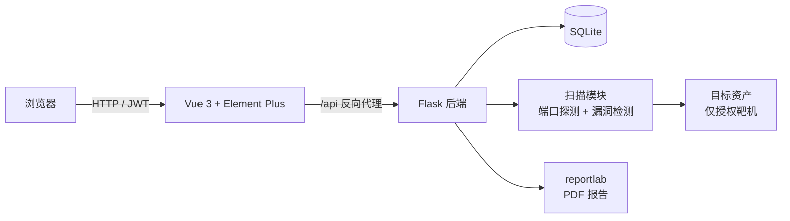
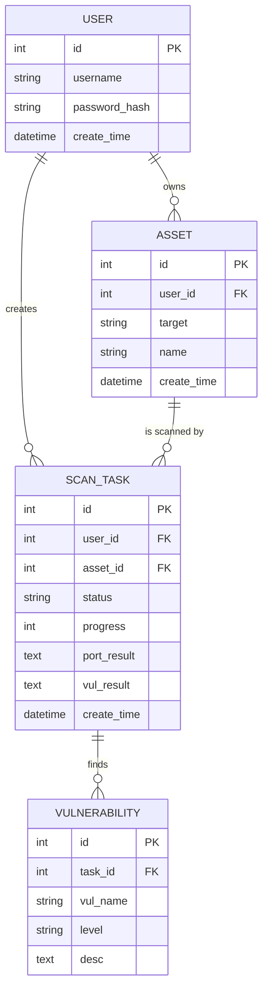
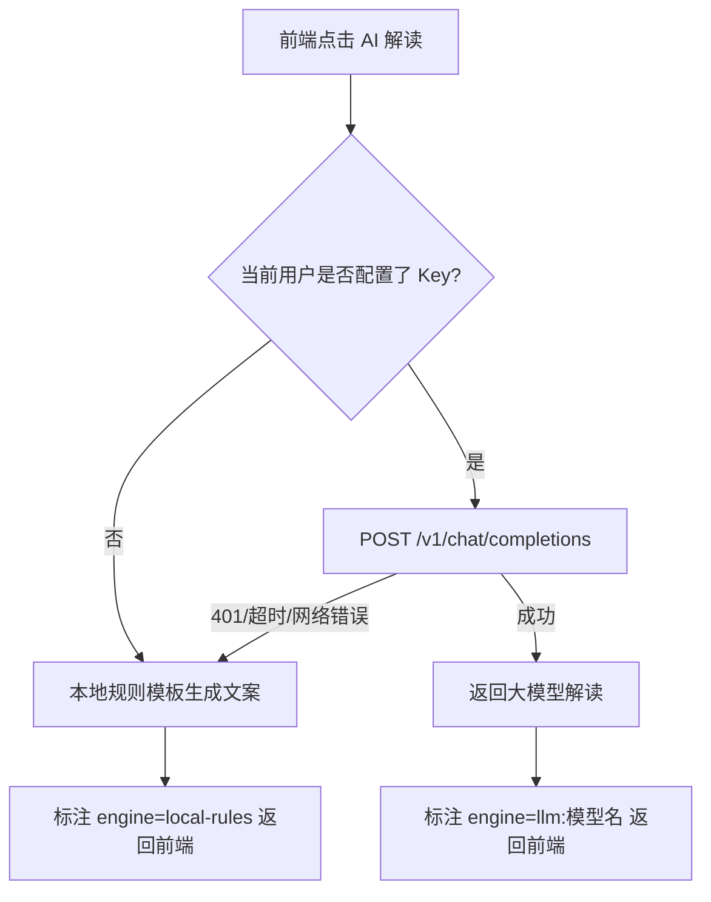

# Web 资产探测与漏洞巡检平台 —— 课程设计报告

| 项目名称 | Web 资产探测与漏洞巡检平台 |
| --- | --- |
| 技术栈 | Vue 3 + Element Plus + Flask + SQLAlchemy + SQLite + ECharts |
| 部署方式 | 本地直跑 / Docker Compose |
| 文档版本 | v1.0 |

---

## 摘要

随着 Web 业务数量的增长，企业与个人开发者需要一种轻量化的工具来持续掌握自己名下资产的安全状况。本课程设计实现了一个前后端分离的 Web 资产探测与漏洞巡检平台，用户在平台上登记自己授权的资产（IP / 域名 / URL），系统异步执行端口探测与常见 Web 漏洞特征检测，并以可视化方式呈现扫描进度、漏洞分布，最终可导出 PDF 格式的巡检报告。系统采用 Vue 3 + Element Plus 构建前端，Flask + SQLAlchemy 构建后端，使用 SQLite 作为数据存储，通过 JWT 完成用户鉴权，整体结构清晰、部署简单，可作为网络安全课程的教学演示与自测工具。

**关键词**：前后端分离；漏洞扫描；Flask；Vue 3；JWT；可视化

---

## 1. 项目背景与意义

在日常开发与运维中，开发者经常需要同时维护多个 Web 站点与服务。传统的商业漏扫工具（如 AWVS、Nessus）部署复杂、授权昂贵，并不适合课程教学与个人自测。本项目面向教学场景，实现一个"够用、好懂、能跑"的轻量化巡检平台：

- **教学价值**：让学生在一个完整的前后端项目中实践 RESTful API、JWT 鉴权、异步任务、数据可视化、PDF 报表等常见工程能力；
- **实践价值**：可作为本地靶机（DVWA、WebGoat）的巡检入口，辅助网络安全课程的实验环节；
- **合规边界**：项目从设计之初就明确"仅扫描授权资产"，并在 README、报告、界面上多次提示，避免被滥用。

---

## 2. 需求分析

### 2.1 功能需求

| 编号 | 模块 | 功能描述 |
| --- | --- | --- |
| F1 | 用户认证 | 注册、登录、JWT 鉴权、退出登录 |
| F2 | 资产管理 | 新增、列表、删除授权资产（IP/域名/URL） |
| F3 | 扫描任务 | 一键启动扫描、异步执行、实时进度查询 |
| F4 | 端口探测 | 对常用端口进行开放状态探测（nmap 优先，socket 降级） |
| F5 | 漏洞检测 | 反射型 XSS、SQL 报错注入的特征检测 |
| F6 | 漏洞展示 | 漏洞列表、按等级（高/中/低）统计饼图 |
| F7 | 报告导出 | 一键导出 PDF 格式的巡检报告 |
| F8 | AI 辅助分析 | AI 解读漏洞、给出修复建议、下一步巡检引导，兼容 OpenAI / DeepSeek / 通义 / 本地 Ollama |

### 2.2 非功能需求

- **易用性**：前端单页应用，操作不超过 3 步即可完成一次扫描；
- **可部署性**：支持本地直跑与 Docker Compose 一键启动；
- **安全性**：密码使用 werkzeug 哈希存储，接口全部走 JWT 鉴权；
- **可扩展性**：扫描器模块化，新增 POC 只需在 `scanner.py` 中追加探测规则。

---

## 3. 系统设计

### 3.1 总体架构



系统分为三层：

1. **表现层**：Vue 3 单页应用，负责用户交互、进度轮询、ECharts 可视化；
2. **业务层**：Flask 提供 RESTful API，处理认证、资产、任务、漏洞、报告五类请求；
3. **数据层**：SQLite 存储用户、资产、任务、漏洞四张表；扫描模块独立封装，便于扩展。

### 3.2 模块划分

```
backend/
├── app.py        # 路由与业务编排
├── db.py         # 数据模型
├── scanner.py    # 扫描核心（端口 + 漏洞）
└── report.py     # PDF 报告生成
```

### 3.3 数据库设计

#### 3.3.1 E-R 图



#### 3.3.2 表结构

**user（用户表）**

| 字段 | 类型 | 说明 |
| --- | --- | --- |
| id | INTEGER PK | 用户 ID |
| username | VARCHAR(64) UNIQUE | 登录名 |
| password_hash | VARCHAR(255) | 密码哈希（werkzeug） |
| create_time | DATETIME | 注册时间 |
| ai_key | VARCHAR(255) | 用户自己的大模型 API Key（可选） |
| ai_base_url | VARCHAR(255) | 大模型接口地址（可选） |
| ai_model | VARCHAR(100) | 大模型名称（可选） |

**asset（资产表）**

| 字段 | 类型 | 说明 |
| --- | --- | --- |
| id | INTEGER PK | 资产 ID |
| user_id | INTEGER FK → user.id | 所属用户 |
| target | VARCHAR(255) | 目标地址，如 http://127.0.0.1:8080 |
| name | VARCHAR(100) | 资产备注名 |
| create_time | DATETIME | 添加时间 |

**scan_task（扫描任务表）**

| 字段 | 类型 | 说明 |
| --- | --- | --- |
| id | INTEGER PK | 任务 ID |
| user_id | INTEGER FK → user.id | 发起人 |
| asset_id | INTEGER FK → asset.id | 被扫资产 |
| status | VARCHAR(20) | pending / running / finish / failed |
| progress | INTEGER | 0–100 |
| port_result | TEXT | 端口探测原始 JSON |
| vul_result | TEXT | 漏洞检测原始 JSON |
| create_time | DATETIME | 创建时间 |

**vulnerability（漏洞表）**

| 字段 | 类型 | 说明 |
| --- | --- | --- |
| id | INTEGER PK | 漏洞记录 ID |
| task_id | INTEGER FK → scan_task.id | 所属任务 |
| vul_name | VARCHAR(200) | 漏洞名称 |
| level | VARCHAR(20) | high / medium / low |
| desc | TEXT | 漏洞描述 |

---

## 4. 接口设计

所有接口前缀 `/api`，除注册/登录外均需在 Header 携带 `Authorization: Bearer <token>`。

| 方法 | 路径 | 说明 |
| --- | --- | --- |
| POST | /api/auth/register | 注册 |
| POST | /api/auth/login | 登录，返回 JWT |
| GET | /api/asset/list | 当前用户资产列表 |
| POST | /api/asset/add | 新增资产 |
| DELETE | /api/asset/del/{id} | 删除资产 |
| POST | /api/task/start | 启动一次扫描（异步） |
| GET | /api/task/list | 任务列表（含进度） |
| GET | /api/vul/list/{task_id} | 某次任务的漏洞列表 |
| GET | /api/report/export/{task_id} | 导出 PDF 报告 |
| GET | /api/ai/status | 查询当前生效的 AI 引擎 |
| GET | /api/ai/config | 获取当前用户 AI 配置（Key 掩码） |
| POST | /api/ai/config | 保存用户 AI 配置 |
| POST | /api/ai/explain/{task_id} | AI 解读漏洞并给出修复建议 |
| POST | /api/ai/suggest/{task_id} | AI 给出下一步巡检/学习建议 |

详细字段见 `docs/API.md`。

---

## 5. 关键实现

### 5.1 JWT 鉴权

后端使用 `flask-jwt-extended`，登录成功后签发 token；前端 Axios 拦截器在每次请求自动带上 `Authorization` 头，收到 401 时清空本地 token 并回到登录页。

### 5.2 异步扫描任务

扫描是耗时操作，直接在请求线程里执行会阻塞接口。后端用 `threading.Thread` 启动后台任务：

1. 创建任务记录，状态置为 `pending`；
2. 后台线程把状态改为 `running`，进度从 20% → 60%（端口探测）→ 90%（漏洞检测）→ 100%（`finish`）；
3. 前端每 3 秒轮询 `/api/task/list`，用 `el-progress` 展示进度条。

### 5.3 扫描器降级策略

优先调用 `nmap` 做准确的端口探测；若运行环境没有安装 nmap，则自动降级为 `socket.connect_ex` 探测常用端口（21/22/80/443/3306/6379/8000/8080/8443），保证项目在任何机器上 clone 下来就能跑演示。

### 5.4 PDF 报告

使用 `reportlab`，注册内置 CID 中文字体 `STSong-Light`（无需额外字体文件），自动生成包含"基本信息表 + 漏洞统计表 + 漏洞明细表 + AI 巡检结论 + 免责声明"的 A4 报告。

### 5.5 AI 辅助分析模块（教学向）

为了让扫描结果不再是一堆干巴巴的 JSON，本项目引入了"AI 助教"角色，把机器扫出来的原始结果翻译成学生能看懂的风险说明、修复建议和下一步学习指引。

#### 5.5.1 安全边界

模块在系统提示词里硬编码了约束：

> 你是一位网络安全教学助教，只对学生已经授权的本地靶机做安全分析……严禁生成攻击性 exploit、严禁提供可直接入侵他人系统的步骤、严禁鼓励未授权测试。

也就是说，AI 只做"解读 + 修复 + 教学引导"，不做"自动打洞"。这一边界在设计上、提示词上、README 与报告的免责声明中都有体现，避免工具被滥用。

#### 5.5.2 配置优先级

为了让项目既能"零配置开箱演示"，又能"接入真实大模型"，配置按以下优先级解析：

```
用户在网页设置里填的 Key  >  启动后端时的环境变量  >  本地规则模板（降级）
```

- 用户级配置存放在 `user` 表的 `ai_key / ai_base_url / ai_model` 三个字段；
- 后端读取时用 `resolve_config()` 合并用户配置与环境变量；
- 任何一级都没有 Key 时，自动降级为基于规则的本地模板（根据端口、漏洞类型给出固定文案），保证功能在任何机器上都不会"空白"。

#### 5.5.3 模型兼容

所有兼容 OpenAI `/chat/completions` 接口的模型都能直接接入，例如：

| 厂商 | Base URL | 模型名示例 |
| --- | --- | --- |
| DeepSeek | https://api.deepseek.com/v1 | deepseek-chat |
| 通义千问 | https://dashscope.aliyuncs.com/compatible-mode/v1 | qwen-plus |
| 智谱 GLM | https://open.bigmodel.cn/api/paas/v4 | glm-4-flash |
| 本地 Ollama | http://127.0.0.1:11434/v1 | qwen2.5 |

用户在网页「🤖 AI 设置」弹窗里填入即可，不用改代码、不用重启服务。

#### 5.5.4 调用与降级流程



无论走哪条路径，返回结果都带 `engine` 字段，前端在 AI 输出区顶部标明当前是"大模型"还是"本地规则"生成的，便于答辩时说明。

#### 5.5.5 Key 的安全处理

- 后端 `GET /api/ai/config` 返回 Key 时做掩码（`sk-t****7890`），不在数据库外回显完整密钥；
- 前端保存时，如果用户没有修改 Key 输入框，传 `KEEP` 占位符，后端识别后保留原值，避免空串覆盖；
- 数据库连接使用本地 SQLite，不上传任何用户 Key 到第三方。

---

## 6. 系统测试

### 6.1 测试环境

- 后端：Python 3.11，Flask 3.0
- 前端：Node 20，Vite 5
- 数据库：SQLite 3
- 靶机：本地运行的测试站点（127.0.0.1）

### 6.2 功能测试用例

| 编号 | 用例 | 输入 | 预期结果 | 实际结果 |
| --- | --- | --- | --- | --- |
| T1 | 用户注册 | username=demo, password=123456 | 返回"注册成功"，数据库新增一条 user | 通过 |
| T2 | 重复注册 | username=demo 再次注册 | 返回"用户名已存在" | 通过 |
| T3 | 登录成功 | 正确账号密码 | 返回 token | 通过 |
| T4 | 登录失败 | 错误密码 | 401，提示账号或密码错误 | 通过 |
| T5 | 未登录访问资产列表 | 不带 token | 401 未授权 | 通过 |
| T6 | 新增资产 | name=本机, target=http://127.0.0.1:5000 | 返回新资产 ID | 通过 |
| T7 | 启动扫描 | asset_id=1 | 返回 task_id，状态 pending | 通过 |
| T8 | 任务进度轮询 | 3 秒后查询 | status 从 running 变为 finish，progress=100 | 通过 |
| T9 | 漏洞列表查询 | task_id=1 | 返回该任务下的漏洞记录 | 通过 |
| T10 | PDF 导出 | task_id=1 | 下载到 vul_report_task_1.pdf，中文正常显示 | 通过 |
| T11 | 删除资产 | 删除 asset_id=1 | 列表中不再出现该资产 | 通过 |
| T12 | AI 配置保存 | 在网页设置填入假 Key + DeepSeek Base URL | 配置持久化，再次读取 Key 被掩码 | 通过 |
| T13 | AI 降级 | 用假 Key 触发大模型调用 | 接口自动降级为 local-rules，返回本地规则文案，不报错 | 通过 |

### 6.3 冒烟测试结果（Flask test client）

```
register:    200  {'msg': '注册成功'}
login:      200  ['token', 'username']
add asset:  200  {'id': 1, 'msg': '添加成功'}
asset list: 200  [{...}]
start task: 200  {'task_id': 1, 'msg': '扫描任务已启动'}
task list:  200  [{'status': 'finish', 'progress': 100, ...}]
report export: 200  content-type: application/pdf  bytes: 3448
```

---

## 7. 部署与运行

### 7.1 本地直跑

```bash
# 后端
cd backend
pip install -r requirements.txt
python app.py        # http://127.0.0.1:5000

# 前端
cd frontend
npm install
npm run dev          # http://127.0.0.1:5173
```

### 7.2 Docker Compose 一键启动

```bash
docker compose up -d --build
# 前端：http://127.0.0.1:8080
# 后端：http://127.0.0.1:5000
```

数据与报告挂载在 `backend/vul.db`、`backend/reports/`。

---

## 8. 安全声明

本项目仅用于**教学、课程作业、技能竞赛演示**，扫描对象必须是：

- 用户本人拥有的主机；
- 已获得书面授权的靶场环境（如 DVWA、WebGoat、本地虚拟机）。

**严禁**未经授权扫描互联网上的任何主机、网站或设备，否则可能违反《中华人民共和国网络安全法》《刑法》第 285 条（非法侵入计算机信息系统罪）、第 286 条（破坏计算机信息系统罪）。因滥用本工具造成的一切后果，由使用者自行承担。

---

## 9. 总结与展望

### 9.1 工作总结

本课程设计完整实现了一个前后端分离的 Web 资产巡检平台，覆盖了用户认证、资产管理、异步扫描、漏洞可视化、PDF 报告导出等核心功能，并通过 Docker Compose 解决了"换台机器就跑不起来"的部署痛点。在开发过程中实践了：

- RESTful API 设计与 JWT 鉴权；
- SQLAlchemy ORM 建模与 SQLite 持久化；
- 后台线程处理耗时任务；
- Vue 3 组合式 API 与 Element Plus、ECharts 集成；
- reportlab 中文 PDF 报表生成。

### 9.2 不足与展望

1. **任务队列**：当前用线程池，并发能力有限，后续可换成 Celery + Redis；
2. **POC 数量**：目前仅实现 XSS、SQL 注入两种特征检测，后续可补充目录遍历、文件包含、未授权访问等规则；
3. **数据可视化**：可增加资产趋势、历史任务对比等图表；
4. **告警**：接入邮件 / Webhook，发现高危漏洞时主动通知。

---

## 10. 参考文献

[1] Flask 官方文档. https://flask.palletsprojects.com/
[2] Vue 3 官方文档. https://cn.vuejs.org/
[3] Element Plus 组件库. https://element-plus.org/
[4] OWASP Top 10 - 2021. https://owasp.org/Top10/
[5] PortSwigger Web Security Academy. https://portswigger.net/web-security
